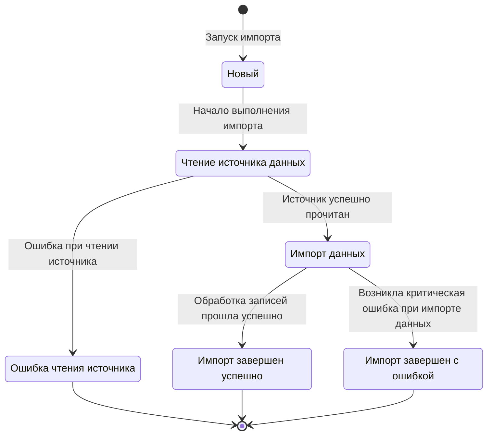

# Системная аналитика - импорт данных

## Необходимый контекст

- [Бизнес аналитика - импорт данных](https://github.com/it-mentor-community-platform/meta/blob/main/business-analytics/functionality/data-import.md)
- Работа с Google Spreadsheet таблицами из Java

## Логическая модель данных процесса импорта

В рамках задачи по аудиту асинхронного импорта выделяется основная сущность `ImportExecution`, описывающая конкретный запуск импорта. Импортируемые бизнес-сущности не являются объектами хранения сервиса `data-importer`: сервис получает их из внешнего источника и передаёт в соответствующие компоненты приложения.

**ImportExecution** — конкретный экземпляр выполнения импорта данных определённого типа. Каждый запуск имеет уникальный идентификатор, текущее состояние и результат выполнения. Информация о запуске используется для отслеживания выполнения и хранения истории импортов.

**ImportType** — классификатор, определяющий набор данных, обрабатываемых в рамках запуска импорта.

Поддерживаемые типы: `USERS`, `PROFILES`, `PROJECTS`, `REVIEWS`, `MENTORS`, `GUARANTEED_REVIEWS`, `QUESTIONS`.

Источником импортируемых данных могут выступать:
Google Spreadsheet — получение данных выполняется сервисом data-importer через Google Sheets API;
Сервисы приложения — получение данных из сервисов рассматривается как отдельный сценарий и будет описываться отдельным флоу.
Источник данных является внешним по отношению к data-importer и не относится к сущностям хранения истории импорта.

## Импортируемые бизнес-сущности

| ImportType | Бизнес-сущность | Назначение |
|---|---|---|
| `USERS` | `User` | Импорт аккаунтов студентов |
| `PROFILES` | `Profile` | Импорт профилей студентов |
| `PROJECTS` | `Project` | Импорт проектов |
| `REVIEWS` | `Review` | Импорт ревью |
| `MENTORS` | `Mentor` | Импорт данных менторов |
| `GUARANTEED_REVIEWS` | `GuaranteedReview` | Импорт данных о доступности и стоимости гарантированного ревью |
| `QUESTIONS` | `Question`, `Category` | Импорт вопросов и категорий для интервального повторения |

## Атрибуты сущности «Запуск импорта»

Для идентификации, отслеживания состояния и сохранения результатов каждого запуска импорта необходимо хранить следующие данные:

| Атрибут | Описание |
|---|---|
| `id` | Уникальный идентификатор запуска импорта |
| `type` | Тип импорта |
| `status` | Текущий или итоговый статус запуска |
| `startedAt` | Дата и время начала выполнения импорта |
| `finishedAt` | Дата и время завершения импорта |
| `successCount` | Количество успешно импортированных сущностей |
| `errorCount` | Количество ошибок при импорте сущностей |
| `sourceReadStatus` | Результат получения данных из источника |

## Диаграмма состояний запуска импорта

### Статусы

| Статус | Описание |
|---|---|
| **Новый** | Запуск импорта создан и принят системой для дальнейшего выполнения. |
| **Ошибка чтения источника** | Сервис не смог получить данные из источника, поэтому импорт не может быть продолжен. |
| **Импорт завершен успешно** | Все необходимые данные обработаны, импорт завершён без критической ошибки. |
| **Импорт завершен с ошибкой** | Во время импорта возникла критическая ошибка, из-за которой выполнение не может быть продолжено. |

### Состояния

| Состояние | Описание |
|---|---|
| **Чтение источника данных** | Сервис получает данные из Google Spreadsheet через Google Sheets API. |
| **Импорт данных** | Сервис обрабатывает полученные данные и передаёт/сохраняет их в целевые системы приложения. |

### Диаграмма состояний

### Легенда

- **Статус** — фиксируемое состояние запуска импорта.
- **Состояние** — этап выполнения процесса импорта.

## Общие допущения

- Все описанные ниже методы доступен только для админов, для простоты запускаем импорт асинхронно в пуле потоков, состоящем из одного потока.  Множественный запуск одновременных процессов импорта в распределённом окружении предотвращен сохранением каждого запуска импорта в БД, и не возможности запустить повторный, до завершения предыдущего 
- Запуск и получение статуса импорта описаны в [схеме REST API](https://github.com/it-mentor-community-platform/meta/blob/main/system-analytics/services/data-importer/index.md#%D1%81%D1%85%D0%B5%D0%BC%D0%B0-rest-api) Data Importer. Результат запуска получаем через `GET /api/data-importer/imports/{id}` (статус, количество успешно и неуспешно импортированных сущностей, `sourceReadStatus`). Ошибка доступа к Google Spreadsheet таблице отражается там как `sourceReadStatus: FAILED`, а не как ошибка запуска

## Импорт пользователей

### Шаги

- Запрос к `POST /api/data-importer/import` с телом `{"type": "USERS"}` и ролью `ADMIN`
- Data Importer валидирует роль пользователя в заголовке `X-User-Roles`
- В случае наличия нужной роли и отсутствия выполняющегося импорта этого типа Data Importer создаёт запуск импорта (`RUNNING`), отвечает `202 Accepted` (с `Location: /api/data-importer/imports/{id}`) и запускает асинхронный процесс импорта данных
  - Открываем Google Spreadsheet таблицу, лист "Telegram аккаунты студентов"
  - Для каждого ряда, кроме заголовка, извлекаем Telegram User Id, определяем роль (об этом ниже)
  - Вызываем `POST /api/auth/internal/user`
- Обработчик `POST /api/auth/internal/user` в Auth Service:
  - Обрабатываем переданный объект, делаем UPSERT пользователю в таблице `Users`, обновляем роли

### Требования

- Конкретная Google Spreadsheet таблица устанавливается через конфиг. Для удобства локальной разработки полезно создать свою копию таблицы и управлять её содержимым (прав на редактирование в основной таблицы у разработчиков нет). Ссылка на основную таблицу есть в [бизнес аналитике](https://github.com/it-mentor-community-platform/meta/blob/main/business-analytics/functionality/data-import.md)
- Роли пользователя могут меняться (как добавляться, так и удаляться)
- Роль каждого импортируемого пользователя - `STUDENT`

### Допущения

- Студенты не могут быть удалены из таблицы, поэтому при синхронизации данных допускаем, что нам не нужно проверять существование в таблице каждого ранее добавленного пользователя

## Импорт менторов

[Продовая таблица](https://docs.google.com/spreadsheets/d/1_EaS3CRoBeo-PG04O2YGOYSk3afdGxgeqd3x0WRLe68/edit?gid=0#gid=0) менторов.

### Шаги

- Запрос к `POST /api/data-importer/import` с телом `{"type": "MENTORS"}` и ролью `ADMIN`
- Data Importer валидирует роль пользователя в заголовке `X-User-Roles`
- В случае наличия нужной роли и отсутствия выполняющегося импорта этого типа Data Importer создаёт запуск импорта (`RUNNING`), отвечает `202 Accepted` (с `Location: /api/data-importer/imports/{id}`) и запускает асинхронный процесс импорта данных
  - Открываем таблицу
  - Для каждого ряда, начиная с 5, читаем Telegram user id, Telegram username, описание (опционально), языки программирования, услуги, имя ментора
    - Вызываем `POST /api/mentor/internal/mentor`
- Обработчик `POST /api/mentor/internal/mentor` в Mentor Service:
  - Обрабатываем переданный объект, отсутствующие ранее услуги в `Services` и языки программирования `Programming_Languages`, и самого ментора в таблицы `Mentors` и `Mentor_Descriptions` попутно создавая все необходимые many-to-many связи. Детальнее - [Схема БД `mentor-service`](https://github.com/it-mentor-community-platform/meta/blob/main/system-analytics/services/mentor-service/index.md#%D1%81%D1%85%D0%B5%D0%BC%D0%B0-%D0%B1%D0%B4)
  - Запрашиваем `GET /api/profile/internal/profile/by-telegram-url`, зная его Telegram url, чтобы убедится что профиль ментора уже существует
  - В случае выполнения предыдущего шага получаем ошибку 404, делаем запрос к `POST /api/profile/internal/profile` для сохранения профиля ментора (например если сам ментор не сдавал проекты ранее)
  - В случае если ментор с таким Telegram user id уже сохранен, возвращаем 409, Data Importer не должен принимать этот статус как ошибку

### Требования

- Конкретная Google Spreadsheet таблица устанавливается через конфиг. Для удобства локальной разработки полезно создать свою копию таблицы и управлять её содержимым (прав на редактирование в основной таблицы у разработчиков нет). Ссылка на основную таблицу - [продовая таблица](https://docs.google.com/spreadsheets/d/1_EaS3CRoBeo-PG04O2YGOYSk3afdGxgeqd3x0WRLe68/edit?gid=0#gid=0)

## Импорт гарантированных ревью

[Продовая таблица](https://docs.google.com/spreadsheets/d/1DkIIcE6oUtcK9jjfrOyUgatb6DIxL5GXEn3kvUp4Lms/edit?gid=0#gid=0) гарантированных ревью.

### Шаги

- Запрос к `POST /api/data-importer/import` с телом `{"type": "GUARANTEED_REVIEWS"}` и ролью `ADMIN`
- Data Importer валидирует роль пользователя в заголовке `X-User-Roles`
- В случае наличия нужной роли и отсутствия выполняющегося импорта этого типа Data Importer создаёт запуск импорта (`RUNNING`), отвечает `202 Accepted` (с `Location: /api/data-importer/imports/{id}`) и запускает асинхронный процесс импорта данных
  - Открываем таблицу
  - Для каждого ряда, начиная с 7, читаем Telegram url ментора, языки, цену
    - Для каждого языка делаем запрос `POST /api/mentor/internal/guaranteed-review`
- Обработчик `POST /api/mentor/internal/guaranteed-review` в Mentor Service:
  - Запрашиваем `GET /api/profile/internal/profile/by-telegram-url`, чтобы получить telegram user id ментора, зная его Telegram url
  - В случае выполнения предыдущего шага получаем 404 - также возвращаем ошибку 404
  - Находим ментора в таблице `Mentors` по полученному telegram user id
  - В случае его отсутствии тоже возвращаем 404 
  - Обрабатываем полученный из запросов объект, сохраняем цены на ревью в таблице `Guaranteed_Reviews_Prices`
  - Если этот проект и язык программирования уже была сохранена для этого ментора, возвращаем 409, Data Importer не должен принимать этот статус как ошибку

### Требования

- Конкретная Google Spreadsheet таблица устанавливается через конфиг. Для удобства локальной разработки полезно создать свою копию таблицы и управлять её содержимым (прав на редактирование в основной таблицы у разработчиков нет). Ссылка на основную таблицу - [продовая таблица](https://docs.google.com/spreadsheets/d/1DkIIcE6oUtcK9jjfrOyUgatb6DIxL5GXEn3kvUp4Lms/edit?gid=0#gid=0)

### Допущения

- Цены на данный момент только в долларах, другие валюты не подразумеваются
- При желании ментора перестать делать ревю на этот проект/язык программирования через платформу, нельзя будет просто удалить записи с таблицы `Guaranteed_Reviews_Prices` иначе они будут заново добавляться при следующих запусках импорта 

## Импорт вопросов для интервального повторения

Импорт производится из нескольких Google Spreadsheet таблиц (1 таблица - 1 специальность).

### Шаги

- Запрос к `POST /api/data-importer/import` с телом `{"type": "QUESTIONS"}` и ролью `ADMIN`
- Data Importer валидирует роль пользователя в заголовке `X-User-Roles`
- Из конфигурации формируется список импортируемых таблиц
- В случае наличия нужной роли и отсутствия выполняющегося импорта этого типа Data Importer создаёт запуск импорта (`RUNNING`), отвечает `202 Accepted` (с `Location: /api/data-importer/imports/{id}`) и запускает асинхронный процесс импорта данных:
  - По очереди открываем Google Spreadsheet таблицы
  - Для каждой Google Spreadsheet таблицы по очереди открываем лист с названием "Ответы - \*", где "\*" - категория вопроса
  - Из названия извлекаем категорию
  - Для каждого ряда, кроме заголовка, извлекаем "Question" и "Answer"
  - Формируем объект из Специализации(определяется обрабатываемой таблицей), Категории, Вопроса и Ответа
  - Вызываем `POST /api/interval-repetition/internal/question`
- Обработчик `POST /api/interval-repetition/internal/question` в Interval Repetition Service:
  - Обрабатываем переданный объект, делаем UPSERT специализации в таблице `Specializations`, категории в таблице `Categories`, вопроса в таблице `Questions`

### Требования

- Специализации и соответствующие им таблицы Google Spreadsheet указываются в конфигурации
- Поле enabled для каждого нового вопроса по умолчанию - `true`

### Допущения
- Так как в таблицах Google Spreadsheet нет уникального идентификатора для вопросов, вопросы идентифицируются по полю title

