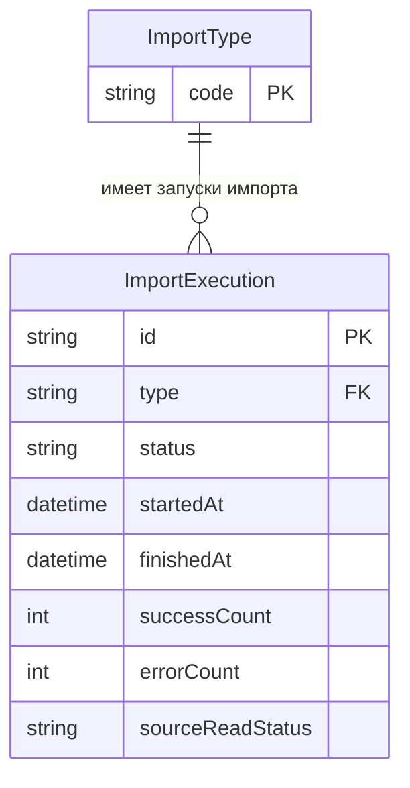

# ER-диаграмма запуска импорта

## Диаграмма

## Сущность `ImportType`

`ImportType` — классификатор типа импорта.

| Атрибут | Ключ |
|---|---|
| `code` | PK |

### Допустимые значения `code`

- `USERS`
- `PROFILES`
- `PROJECTS`
- `REVIEWS`
- `MENTORS`
- `GUARANTEED_REVIEWS`
- `QUESTIONS`

## Сущность `ImportExecution`

`ImportExecution` — конкретный запуск импорта.

| Атрибут | Ключ |
|---|---|
| `id` | PK |
| `type` | FK |
| `status` | — |
| `startedAt` | — |
| `finishedAt` | — |
| `successCount` | — |
| `errorCount` | — |
| `sourceReadStatus` | — |

## Ключи

### Первичный ключ

- `ImportType`: `code`
- `ImportExecution`: `id`

### Внешний ключ

- `ImportExecution`: `type` → `ImportType.code`

## Связь между сущностями

| Связь | Кардинальность | Описание |
|---|---|---|
| `ImportType` — `ImportExecution` | `1 : 0..*` | Один тип импорта может иметь 0 или множество запусков импорта. Каждый запуск импорта относится ровно к одному типу импорта. |
