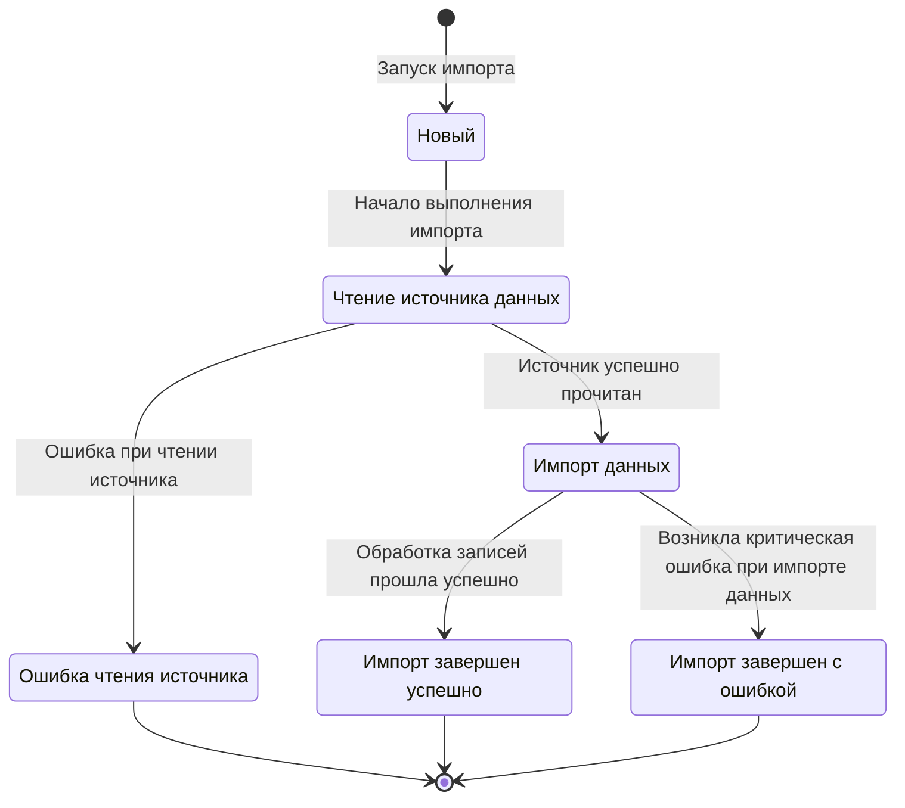

# Диаграмма состояний запуска импорта

## Статусы

| Статус | Описание |
|---|---|
| **Новый** | Запуск импорта создан и принят системой для дальнейшего выполнения. |
| **Ошибка чтения источника** | Сервис не смог получить данные из источника, поэтому импорт не может быть продолжен. |
| **Импорт завершен успешно** | Все необходимые данные обработаны, импорт завершён без критической ошибки. |
| **Импорт завершен с ошибкой** | Во время импорта возникла критическая ошибка, из-за которой выполнение не может быть продолжено. |

## Состояния

| Состояние | Описание |
|---|---|
| **Чтение источника данных** | Сервис получает данные из Google Spreadsheet через Google Sheets API. |
| **Импорт данных** | Сервис обрабатывает полученные данные и передаёт/сохраняет их в целевые системы приложения. |

## Диаграмма состояний

## Легенда

- **Статус** — фиксируемое состояние запуска импорта.
- **Состояние** — этап выполнения процесса импорта.
