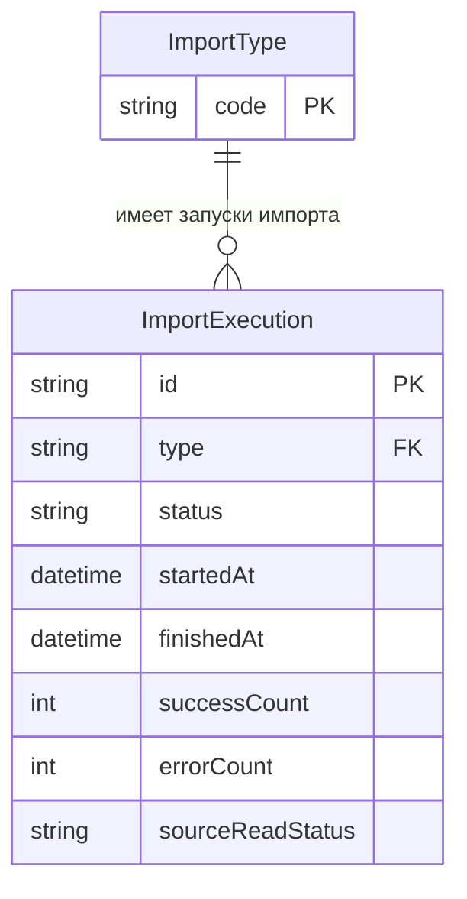

# Data Importer

## Необходимый контекст

- [Бизнес аналитика](https://github.com/it-mentor-community-platform/meta/blob/main/business-analytics/functionality/data-import.md) импорта данных

## Стек

- Spring Boot 3
- [Google API Java Client](https://github.com/googleapis/google-api-java-client) для работы с Google Sheets API

У сервиса нет своей БД.

## Взаимодействия

Входящие:

- REST эндпоинты
- Kafka

Исходящие:

- Запросы к REST эндпоинту [`POST /api/auth/internal/user`](https://github.com/it-mentor-community-platform/meta/blob/main/system-analytics/services/auth-service/index.md#%D0%B2%D0%BD%D1%83%D1%82%D1%80%D0%B5%D0%BD%D0%BD%D0%B8%D0%B9-%D1%8D%D0%BD%D0%B4%D0%BF%D0%BE%D0%B8%D0%BD%D1%82-%D0%B4%D0%BB%D1%8F-%D1%81%D0%BE%D0%B7%D0%B4%D0%B0%D0%BD%D0%B8%D1%8F-%D0%BF%D0%BE%D0%BB%D1%8C%D0%B7%D0%BE%D0%B2%D0%B0%D1%82%D0%B5%D0%BB%D0%B5%D0%B9) Auth Servic'а для создания пользователя

## Схема REST API

Для всех методов передаются [кастомные заголовки запроса](https://github.com/it-mentor-community-platform/meta/blob/main/system-analytics/services/gateway/index.md#%D0%BF%D1%80%D0%B0%D0%B2%D0%B8%D0%BB%D0%B0-security) с Telegram Id и ролями пользователя (но принимаются только необходимые в рамках конкретного запроса).

### Ответ в случае ошибки

Актуально для всех методов.

Код должен соответствовать ситуации (перечислено ниже), тело:
```
{
  "message": "Текст ошибки"
}
```

### Запуск импорта пользователей

`POST /api/data-importer/start-users-import`

Метод требует наличия роли `ADMIN`.

Ответ в случае успеха: `200 OK`.

Коды ошибок:
- 401 - пользователь неавторизован (в запросе отсутствует заголовок `X-Telegram-User-Id`)
- 403 - у пользователя нет роли `ADMIN`

### Запуск импорта профилей

`POST /api/data-importer/start-profiles-import`

Метод требует наличия роли `ADMIN`.

Для импорта используется [эндпоинт](https://github.com/it-mentor-community-platform/meta/blob/main/system-analytics/services/profile-service/index.md#внутренний-эндпоинт-для-импорта-профиля) `PUT /api/profile/internal/profile`.

Ответ в случае успеха: `200 OK`.

Коды ошибок:
- 401 - пользователь неавторизован (в запросе отсутствует заголовок `X-Telegram-User-Id`)
- 403 - у пользователя нет роли `ADMIN`

Обратите внимание, что в Google таблице хранятся Telegram юзернеймы, а при импорте нам нужны ссылки на профиль. Необходимо преобразовать профиль в ссылку, пример `@zhukovsd` -> `https://t.me/zhukovsd`.

### Запуск импорта проектов

`POST /api/data-importer/start-projects-import`

Метод требует наличия роли `ADMIN`.

[Системная аналитика](https://github.com/it-mentor-community-platform/meta/blob/main/system-analytics/functionality/projects-bookkeeping.md) процесса.

Ответ в случае успеха: `200 OK`.

Коды ошибок:
- 401 - пользователь неавторизован (в запросе отсутствует заголовок `X-Telegram-User-Id`)
- 403 - у пользователя нет роли `ADMIN`

### Запуск импорта коллекции ревью

`POST /api/data-importer/start-reviews-import`

Метод требует наличия роли `ADMIN`.

Для импорта используется [эндпоинт](https://github.com/it-mentor-community-platform/meta/blob/main/system-analytics/services/project-service/index.md#%D0%B2%D0%BD%D1%83%D1%82%D1%80%D0%B5%D0%BD%D0%BD%D0%B8%D0%B9-%D1%8D%D0%BD%D0%B4%D0%BF%D0%BE%D0%B8%D0%BD%D1%82-%D0%B4%D0%BB%D1%8F-%D0%B4%D0%BE%D0%B1%D0%B0%D0%B2%D0%BB%D0%B5%D0%BD%D0%B8%D1%8F-%D1%80%D0%B5%D0%B2%D1%8C%D1%8E-%D0%B8%D0%B7-data-importer) `POST /api/project/internal/review`.

Ответ в случае успеха: `200 OK`.

Коды ошибок:
- 401 - пользователь неавторизован (в запросе отсутствует заголовок `X-Telegram-User-Id`)
- 403 - у пользователя нет роли `ADMIN`

### Запуск импорта менторов

`POST /api/data-importer/start-mentors-import`

Метод требует наличия роли `ADMIN`.

Шаги описаны в [системной аналитике](https://github.com/it-mentor-community-platform/meta/blob/main/system-analytics/functionality/data-import.md#%D0%B8%D0%BC%D0%BF%D0%BE%D1%80%D1%82-%D0%BC%D0%B5%D0%BD%D1%82%D0%BE%D1%80%D0%BE%D0%B2) импорта данных.

Ответ в случае успеха: `200 OK`.

Коды ошибок:
- 401 - пользователь неавторизован (в запросе отсутствует заголовок `X-Telegram-User-Id`)
- 403 - у пользователя нет роли `ADMIN`

### Запуск импорта гарантированных ревью

`POST /api/data-importer/start-guaranteed-reviews-import`

Метод требует наличия роли `ADMIN`.

Шаги описаны в [системной аналитике](https://github.com/it-mentor-community-platform/meta/blob/main/system-analytics/functionality/data-import.md#%D0%B8%D0%BF%D0%BC%D0%BF%D0%BE%D1%80%D1%82-%D0%B3%D0%B0%D1%80%D0%B0%D0%BD%D1%82%D0%B8%D1%80%D0%BE%D0%B2%D0%B0%D0%BD%D0%BD%D1%8B%D1%85-%D1%80%D0%B5%D0%B2%D1%8C%D1%8E) импорта данных.

Ответ в случае успеха: `200 OK`.

Коды ошибок:
- 401 - пользователь неавторизован (в запросе отсутствует заголовок `X-Telegram-User-Id`)
- 403 - у пользователя нет роли `ADMIN`

### Запуск импорта вопросов

`/api/data-importer/start-questions-import`

Метод требует наличия роли `ADMIN`.

Шаги описаны в [системной аналитике](https://github.com/it-mentor-community-platform/meta/blob/main/system-analytics/functionality/data-import.md#%D0%B8%D0%BF%D0%BC%D0%BF%D0%BE%D1%80%D1%82-%D0%B3%D0%B0%D1%80%D0%B0%D0%BD%D1%82%D0%B8%D1%80%D0%BE%D0%B2%D0%B0%D0%BD%D0%BD%D1%8B%D1%85-%D1%80%D0%B5%D0%B2%D1%8C%D1%8E) импорта данных.

Ответ в случае успеха: `200 OK`.

Коды ошибок:
- 401 - пользователь неавторизован (в запросе отсутствует заголовок `X-Telegram-User-Id`)
- 403 - у пользователя нет роли `ADMIN`


## Kafka

### Consumer для топика `projects.project.created`

Consumer group - `data-importer-cg`.

[Описание формата](https://github.com/it-mentor-community-platform/meta/blob/main/system-analytics/services/project-service/index.md#producer-%D0%B4%D0%BB%D1%8F-%D1%82%D0%BE%D0%BF%D0%B8%D0%BA%D0%B0-projectsprojectcreated) сообщения.

Используется для добавления записи о проекте в Google Spreadsheet таблицу. 

[Системная аналитика](https://github.com/it-mentor-community-platform/meta/blob/main/system-analytics/functionality/projects-bookkeeping.md) процесса.

### Consumer для топика `reviews.review.created`

Consumer group - `data-importer-cg`.

Используется для добавления записи о ревью в Google Spreadsheet таблицу. 

Payload сообщения - https://github.com/it-mentor-community-platform/meta/blob/main/system-analytics/services/project-service/index.md#producer-%D0%B4%D0%BB%D1%8F-%D1%82%D0%BE%D0%BF%D0%B8%D0%BA%D0%B0-reviewsreviewcreated.

## ER-диаграмма запуска импорта

### Диаграмма



### Сущность `ImportType`

`ImportType` — классификатор типа импорта.

Атрибут - `code`, ключ - `PK`

### Допустимые значения `code`

- `USERS`
- `PROFILES`
- `PROJECTS`
- `REVIEWS`
- `MENTORS`
- `GUARANTEED_REVIEWS`
- `QUESTIONS`

### Сущность `ImportExecution`

`ImportExecution` — конкретный запуск импорта.

| Атрибут | Ключ |
|---|---|
| `id` | PK |
| `type` | FK |
| `status` | — |
| `startedAt` | — |
| `finishedAt` | — |
| `successCount` | — |
| `errorCount` | — |
| `sourceReadStatus` | — |

### Ключи

### Первичный ключ

- `ImportType`: `code`
- `ImportExecution`: `id`

### Внешний ключ

- `ImportExecution`: `type` → `ImportType.code`

### Связь между сущностями

| Связь | Кардинальность | Описание |
|---|---|---|
| `ImportType` — `ImportExecution` | `1 : 0..*` | Один тип импорта может иметь 0 или множество запусков импорта. Каждый запуск импорта относится ровно к одному типу импорта. |
