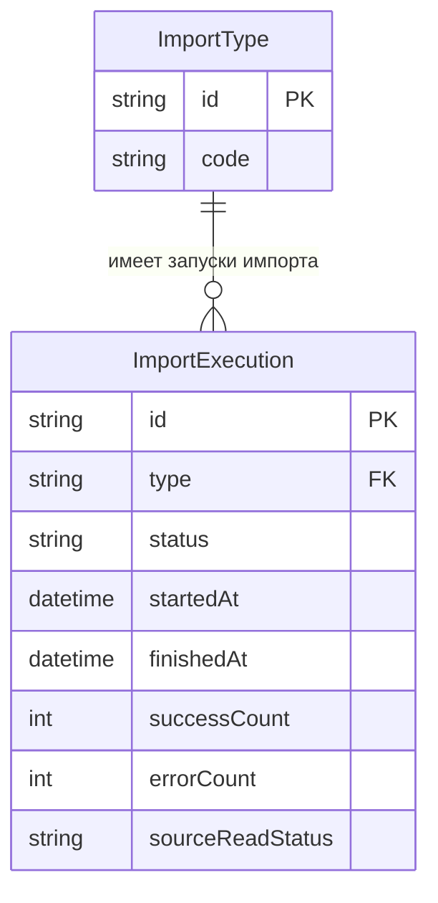

[data-importer-rest-api-updated.md](https://github.com/user-attachments/files/34186003/data-importer-rest-api-updated.md)# Data Importer

## Необходимый контекст

- [Бизнес аналитика](https://github.com/it-mentor-community-platform/meta/blob/main/business-analytics/functionality/data-import.md) импорта данных

## Стек

- Spring Boot 3
- [Google API Java Client](https://github.com/googleapis/google-api-java-client) для работы с Google Sheets API

У сервиса нет своей БД.

## Взаимодействия

Входящие:

- REST эндпоинты
- Kafka

Исходящие:

- Запросы к REST эндпоинту [`POST /api/auth/internal/user`](https://github.com/it-mentor-community-platform/meta/blob/main/system-analytics/services/auth-service/index.md#%D0%B2%D0%BD%D1%83%D1%82%D1%80%D0%B5%D0%BD%D0%BD%D0%B8%D0%B9-%D1%8D%D0%BD%D0%B4%D0%BF%D0%BE%D0%B8%D0%BD%D1%82-%D0%B4%D0%BB%D1%8F-%D1%81%D0%BE%D0%B7%D0%B4%D0%B0%D0%BD%D0%B8%D1%8F-%D0%BF%D0%BE%D0%BB%D1%8C%D0%B7%D0%BE%D0%B2%D0%B0%D1%82%D0%B5%D0%BB%D0%B5%D0%B9) Auth Servic'а для создания пользователя

## ER-диаграмма запуска импорта

### Диаграмма


[Описание сущностей и связей](https://github.com/it-mentor-community-platform/meta/blob/main/system-analytics/services/data-importer/er-import-entities-and-relations.md)

## Схема REST API

Для всех методов передаются кастомные заголовки запроса с ролями пользователя.

Все методы требуют наличия роли `ADMIN`.

### Ответ в случае ошибки

Актуально для всех методов.

Код должен соответствовать ситуации (перечислено ниже), тело:

```json
{
  "message": "Текст ошибки"
}
```

### Запуск импорта

`POST /api/data-importer/imports`

Запускает асинхронный импорт данных указанного типа.

Тип импорта передаётся единственным полем в теле запроса.

Тело запроса (`Content-Type: application/json`):

```json
{
  "type": "USERS"
}
```

В случае успешного запуска создаётся новый `ImportExecution` со статусом `RUNNING`.

Ответ в случае успеха: `202 Accepted`.

В header `Location` возвращается эндпоинт для получения состояния созданного запуска:

```text
/api/data-importer/imports/{id}
```

Тело ответа (`Content-Type: application/json`):

```json
{
  "id": 125,
  "type": "USERS",
  "status": "RUNNING"
}
```

Коды ошибок:

- `403` - у пользователя нет роли `ADMIN`;
- `409` - импорт указанного типа уже выполняется;
- `409` - не выполнены условия для запуска импорта указанного типа;
- `500` - неизвестная ошибка.

### Получение статуса конкретного импорта

`GET /api/data-importer/imports/{id}`

Метод требует наличия роли `ADMIN`.

Возвращает текущее состояние конкретного запуска импорта.

`id` - идентификатор `ImportExecution`.

Ответ в случае успеха: `200 OK`.

Тело ответа (`Content-Type: application/json`):

```json
{
  "id": 125,
  "type": "USERS",
  "status": "SUCCESS",
  "startedAt": 1761834600,
  "finishedAt": 1761834867,
  "successCount": 498,
  "errorCount": 2,
  "sourceReadStatus": "SUCCESS"
}
```

Возможные значения `status`:

- `RUNNING` - импорт выполняется;
- `SUCCESS` - импорт завершён успешно;
- `FAILED` - импорт завершён с ошибкой.

Если импорт ещё выполняется, `finishedAt` имеет значение `null`.

Пример:

```json
{
  "id": 125,
  "type": "USERS",
  "status": "RUNNING",
  "startedAt": 1761834600,
  "finishedAt": null,
  "successCount": 320,
  "errorCount": 2,
  "sourceReadStatus": "SUCCESS"
}
```

`sourceReadStatus` содержит результат чтения источника данных.

Если источник данных прочитан успешно:

```text
SUCCESS
```

Если получить данные из источника не удалось:

```text
FAILED
```

Пример импорта, завершившегося ошибкой при чтении источника:

```json
{
  "id": 132,
  "type": "USERS",
  "status": "FAILED",
  "startedAt": 1761834600,
  "finishedAt": 1761834604,
  "successCount": 0,
  "errorCount": 0,
  "sourceReadStatus": "FAILED"
}
```

Если источник был успешно прочитан, но импорт завершился ошибкой на последующих этапах:

```json
{
  "id": 133,
  "type": "PROJECTS",
  "status": "FAILED",
  "startedAt": 1761834600,
  "finishedAt": 1761834735,
  "successCount": 120,
  "errorCount": 1,
  "sourceReadStatus": "SUCCESS"
}
```

Статус `FAILED` в теле ответа характеризует результат выполнения самого импорта. При успешном получении информации о запуске HTTP-код ответа остаётся `200 OK`.

Коды ошибок:

- `403` - у пользователя нет роли `ADMIN`;
- `404` - запуск импорта с указанным `id` не найден;
- `500` - неизвестная ошибка.
i-updated.md…]()


## Kafka

### Consumer для топика `projects.project.created`

Consumer group - `data-importer-cg`.

[Описание формата](https://github.com/it-mentor-community-platform/meta/blob/main/system-analytics/services/project-service/index.md#producer-%D0%B4%D0%BB%D1%8F-%D1%82%D0%BE%D0%BF%D0%B8%D0%BA%D0%B0-projectsprojectcreated) сообщения.

Используется для добавления записи о проекте в Google Spreadsheet таблицу. 

[Системная аналитика](https://github.com/it-mentor-community-platform/meta/blob/main/system-analytics/functionality/projects-bookkeeping.md) процесса.

### Consumer для топика `reviews.review.created`

Consumer group - `data-importer-cg`.

Используется для добавления записи о ревью в Google Spreadsheet таблицу. 

Payload сообщения - https://github.com/it-mentor-community-platform/meta/blob/main/system-analytics/services/project-service/index.md#producer-%D0%B4%D0%BB%D1%8F-%D1%82%D0%BE%D0%BF%D0%B8%D0%BA%D0%B0-reviewsreviewcreated.

[data-importer-rest-api.md](https://github.com/user-attachments/files/34144441/data-importer-rest-api.md)

